<!-- ───────────────── HEADER ───────────────── -->

 

 

> 규칙을 설계하는 데서 멈추지 않고 **플레이 가능한 빌드**와 **운영 중인 서비스**까지 직접 만든 뒤,
> 시뮬레이션과 실데이터로 다시 판단합니다.

<!-- ───────────────── STAT SHEET ───────────────── -->
## 🎲 Stat Sheet

| 지표 | 값 |
|:--|--:|
| 1구역 돌파율 · OUTLUCK 밸런스 시뮬 | **`14% → 68%`** |
| 밸런스 시뮬레이션 1회 표본 | **`2,000 런`** |
| 수치로 찾아 제거한 지배전략 | **`4 건`** |
| 기획한 아이템 · 상태 효과 (저주받은 도시) | **`53 · 13 종`** |
| 페이지뷰당 서버 요청 · Urnlock | **`−75%`** |
| 머지된 PR · 리뷰 | **`102 · 193`** |

<!-- ───────────────── PROJECTS ───────────────── -->
## 🕹️ Featured Projects

<table>
<tr>
<td width="33%" valign="top">

### 🤠 OUTLUCK
가제 HIGH NOON · 개인 · 2026.08 –

**서부 턴제 결투 로그라이크.**
모든 확률이 보이는 상태에서, 방아쇠 한 번의 위험을 얼마나 삼킬지 정한다.

- 전투 엔진을 순수 C#으로 분리 → 2,000런 몬테카를로
- 지배전략 4건 제거 · 설계 결정 로그 45+
- 노드맵을 걷어내고 3막 × 12장 구조로 피벗

 

</td>
<td width="33%" valign="top">

### 🏚️ 저주받은 도시
가제 · 5인 팀 · 2025.09 – 11 · MVP

**탐험형 턴제 로그라이크.**
시간이 흐를수록 시야가 바뀌고, 시간대에 따라 선공이 바뀐다.

- 게임 전체 기획 + 핵심 시스템 클라이언트 구현
- 아이템 53종 · 상태 효과 13종 시너지 설계
- Notion 칸반으로 팀 과제 22개 관리

 

</td>
<td width="33%" valign="top">

### 🌙 [Urnlock](https://www.urnlock.com)
Deadlock 통계 웹 · 1인 · 운영 중

**“지금 고르면 이기나”에 답하는 게임 정보 서비스.**

- 티어 모델 재설계 · 무결성 게이트로 오배포 차단
- Cloudflare + Vercel 분리로 요청 −75%
- 한 · 영 · 중 3개 언어, 사이트맵 214개 주소

 

</td>
</tr>
</table>

<!-- ───────────────── STACK ───────────────── -->
## 🛠️ Tech Stack

**🎮 Game** 

**🌐 Web / Frontend** 

**🧰 Tools** 

<!-- ───────────────── STATS ───────────────── -->
## 📊 GitHub Stats

<!-- 아래 팩맨 그래프는 .github/workflows/pacman.yml 을 함께 올리면 하루 한 번 자동 생성됩니다 -->

<!-- ───────────────── CERT & CONTACT ───────────────── -->
## 🏅 Experience · Cert

- **인디제이** 개발팀 인턴 2026.07 – 08 — 음성 인식 AI 위험감지 시스템 백엔드·프론트엔드, 커넥티드카 대시보드 UI
- **정보처리기사** 2026.06

## 📫 Contact

